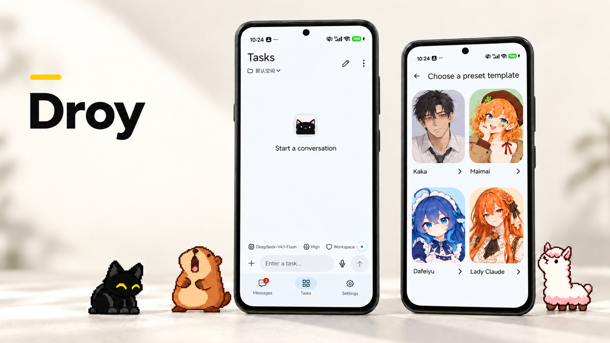
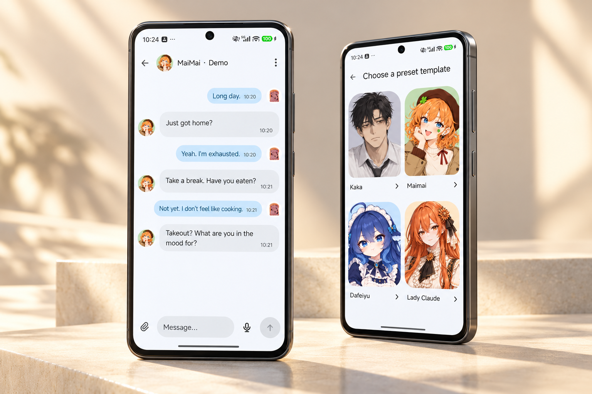
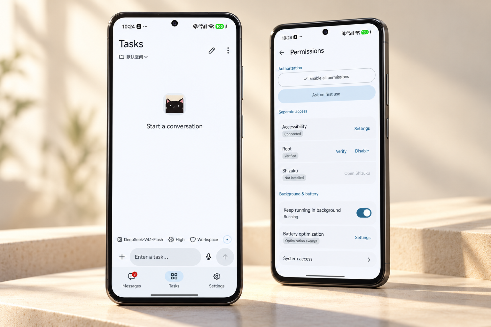
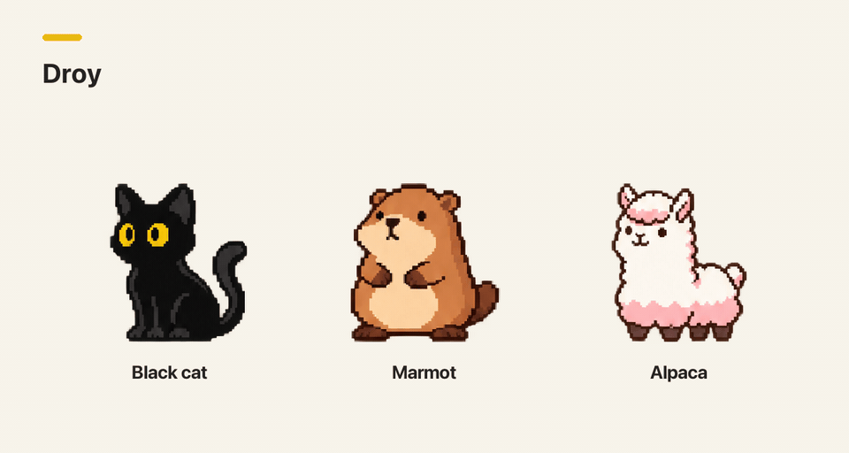
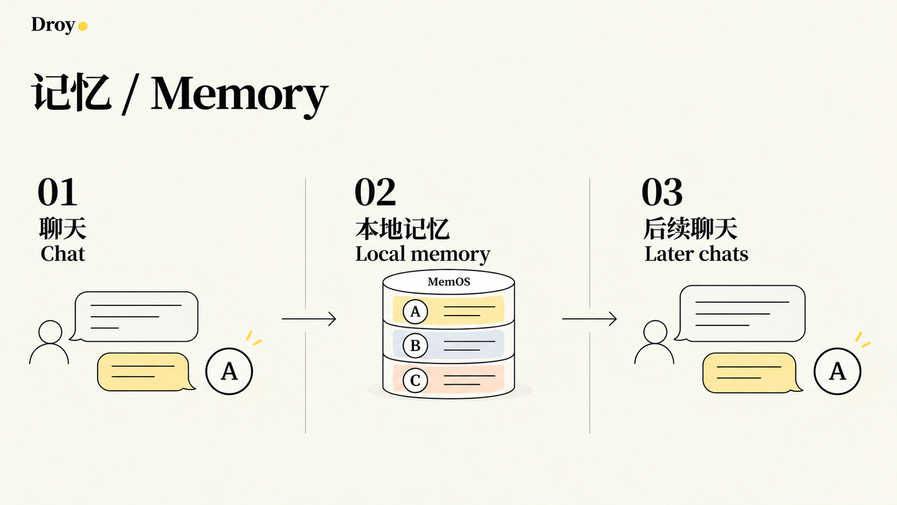

# Droy

**English** · [简体中文](README.zh-CN.md)

<p>
<a href="https://github.com/moonoops/Droy/releases/latest"></a>
<a href="#get-started"></a>
<a href="LICENSE"></a>
</p>

Droy is an open-source Android AI assistant for conversation, research and phone tasks.

[**Download APK**](https://github.com/moonoops/Droy/releases/latest) · [Installation guide](INSTALLATION.md) · [v0.0.3 release notes](https://github.com/moonoops/Droy/releases/tag/v0.0.3) · [Report an issue](https://github.com/moonoops/Droy/issues)

**ARM64** · Chinese / English

[](assets/readme/hero-studio.en.png)

Talk to a companion in Messages, or ask an agent to operate your phone in Tasks. The runtime runs on your phone, so you can disconnect your computer after setup. You choose the model service; cloud models need an internet connection.

[Features](#features) · [Install and get started](#get-started) · [Permissions and data](#permissions) · [FAQ](#faq) · [Development](#development)

<a id="features"></a>

## Features

<a id="companions"></a>

### Companion chat

Choose from Kaka, Maimai, Dafeiyu and Lady Claude. A fresh installation creates Kaka, and you can add other companions whenever you want. Each has separate chat history and memory, and can use its own model.

- Change names, avatars, personalities and speaking styles.
- Choose from eight chat backgrounds or upload an image.
- Use stickers and GIFs, search online, or import sticker packs.
- Enable proactive messages and set quiet hours. The default quiet period is 22:00–09:00.

Companions can search the web, organize information and work in the background, then send the results back to the chat. Use Tasks when you want to open an app, tap or enter text on your phone.

[](assets/readme/companions-studio.en.png)

<a id="agent"></a>

### Phone tasks

Describe what you want to do in Tasks. The agent plans the steps, uses Android Use to inspect pages, tap, swipe and enter text, then checks the result. You can add attachments, use voice input, and organize work into spaces and conversations.

The agent hands sign-in, verification codes and other steps that need your input back to you. You can stop a task at any time.

[](assets/readme/tasks-studio.en.png)

<a id="pets"></a>

### On-screen pets

Choose a black cat, marmot or alpaca in Pet Studio and preview their animations. During a task, pet bubbles let you check progress, answer questions, pause, resume or stop the task.

<picture>
  <source media="(prefers-reduced-motion: reduce)" srcset="assets/readme/pets.en.png">
  
</picture>

<a id="memory"></a>

### Memory

Droy extracts useful information from conversations and retrieves relevant records in later chats. Each companion's memory is kept separate, and you can turn it off in that companion's settings.

Companion memory uses MemOS modules for local storage and retrieval. Deleting a companion leaves its memory on your phone. To restore or permanently delete it, make a request in Tasks.

[](assets/readme/memory.bilingual.png)

<a id="more"></a>

### Other features

| Feature | Details |
| --- | --- |
| Voice | Hold to speak, voice conversations and reply read-aloud. |
| Notifications | Set rules for selected apps, filter ads and get reminders about important messages. |
| Native interface | Kotlin / Compose, Chinese and English, light and dark themes. Portrait only. |
| Extensions | Skills, plugins, MCP and automation in Tasks through DSH. |

<a id="get-started"></a>

## Install and get started

You need an ARM64 phone running Android 11 or later, with an up-to-date system WebView.

### Install the APK directly (recommended)

1. Download the APK from [Releases](https://github.com/moonoops/Droy/releases/latest), then open and install it on your phone.
2. Follow setup to choose a model service and enter your API key on the phone.
3. Set up the permissions you need, then start a chat in Messages or enter an instruction in Tasks.

The APK includes the runtime. When upgrading, install an APK with the same signature over the existing app.

<details>
  <summary>Or let a computer agent install it over USB</summary>

Connect your phone by USB, enable USB debugging in Developer options, and authorize the computer on your phone. Then give an agent that can run local commands this prompt:

```text
Follow INSTALLATION.md at https://github.com/moonoops/Droy
to install Droy on my USB-connected Android phone.
Check the connection and tools, use the official release APK
and verify its checksum. Keep existing data and configure
features and permissions according to my choices.
Finish installation and basic checks. Tell me when phone
confirmation is needed. I will enter the API key on the phone.
```

The computer-side tools support macOS, Linux and Windows, and need Python 3.8+ and ADB. See the [installation guide](INSTALLATION.md) for details.

</details>

<a id="troubleshooting"></a>

### Troubleshoot with an agent over USB

Connect the phone, enable USB debugging and authorize your computer. Give the computer agent a description of the problem and this prompt:

```text
Use https://github.com/moonoops/Droy to troubleshoot Droy
on my USB-connected Android phone.
Check the connection, app version, permissions and relevant logs,
then identify and fix the cause.
Keep my chats, memories and configuration.
Tell me when phone confirmation is needed.
I will enter the API key on the phone.
```

<a id="permissions"></a>

## Permissions and data

### Setting up permissions

Companion chat, on-screen pets and personal memory work without Root. Basic phone operations use Accessibility; Shizuku and Root provide some additional capabilities. The permissions page shows what is available on your phone.

You can start permission setup in one place and work through the Android confirmations, or choose to be asked when a feature is first used. Accessibility, Root and Shizuku are authorized separately.

Personal memory and automatic organization are enabled by default. You choose whether to enable additional sources such as phone usage, page content, device state and location. Adjust sources and model-processing authorization in settings.

### What the model receives

Replies, task planning and memory extraction use your configured model. Depending on the task and your authorization, relevant messages, memories, page text, screenshots and attachments are sent to the selected model service.

- Speech recognition runs on the phone, and the recognized text is used in conversation. Read-aloud uses your chosen speech engine.
- Notification organization sends the notification text and rules that need model analysis to the model.

Memory is stored on your phone, with no cloud sync at present. Model providers set their own fees and data terms.

<a id="faq"></a>

## FAQ

<details>
  <summary>Do I have to use a DeepSeek model?</summary>

No. You can add a supported model service in settings. To understand screenshots, choose a model and endpoint that accept images. Text-only models can use page text and control structure.

</details>

<details>
  <summary>What if messages stop arriving in the background?</summary>

Enable Android notifications, turn on Droy's background-running setting, and set battery and auto-start permissions as required by your phone. Reopen Droy after a system force-stop or restart.

</details>

<details>
  <summary>Does notification organization change the original app's alerts?</summary>

Original app alerts are preserved by default. Silent takeover needs separate confirmation and Root. Before uninstalling, turn notification organization off and check that the affected settings have been restored. After a force-stop or loss of Root, reopen Droy, grant the required access and check the restoration result.

</details>

<a id="development"></a>

## Development and contributions

The native interface uses Kotlin / Compose. DSH provides agent planning, model calls and sessions; Droy manages authorization, task state and data; Android Use connects the phone's native executors.

[Build guide](BUILDING.md) · [Testing](TESTING.md) · [Dependency versions](runtime/release.json)

When reporting an issue, include the Droy version, phone model, Android version, Root status and steps to reproduce it. Remove keys and personal information from shared logs and screenshots. Submit fixes and improvements through [pull requests](https://github.com/moonoops/Droy/pulls).

<a id="acknowledgements"></a>

## Acknowledgements

- **[DeepSeek Harness (DSH)](https://github.com/deepseek-ai/deepseek-harness)** provides the agent engine, model calls, sessions and extensions.
- **[MaiBot](https://github.com/Mai-with-u/MaiBot)** contributes the dialogue-planning and reply templates, Maimai's personality, and expression-learning implementations adapted for Droy's one-to-one chats. [Adaptation notes](runtime/mobile/companions/maibot/README.md).
- **[MemOS](https://github.com/MemTensor/MemOS)** provides local storage and retrieval modules for companion memory, with Android adaptation and per-companion isolation added by Droy. [Integration notes](runtime/memory/memos/README.md).

Thank you to the authors and contributors who made these projects open source, to the [LINUX DO community](https://linux.do), and to everyone helping test and improve Droy.

<a id="license"></a>

## License

Droy's own code is licensed under [AGPL-3.0-only](LICENSE). Third-party code, models and assets retain their respective licenses. See [THIRD_PARTY_NOTICES.md](THIRD_PARTY_NOTICES.md).

Maintained by [@moonoops](https://github.com/moonoops).

<a id="star-history"></a>

## Star history

<div align="center">

<a href="https://www.star-history.com/?repos=moonoops%2FDroy&amp;type=date&amp;legend=top-left">
  <picture>
    <source media="(prefers-color-scheme: dark)" srcset="https://api.star-history.com/chart?repos=moonoops/Droy&amp;type=date&amp;theme=dark&amp;legend=top-left" />
    <source media="(prefers-color-scheme: light)" srcset="https://api.star-history.com/chart?repos=moonoops/Droy&amp;type=date&amp;legend=top-left" />
    
  </picture>
</a>

</div>
