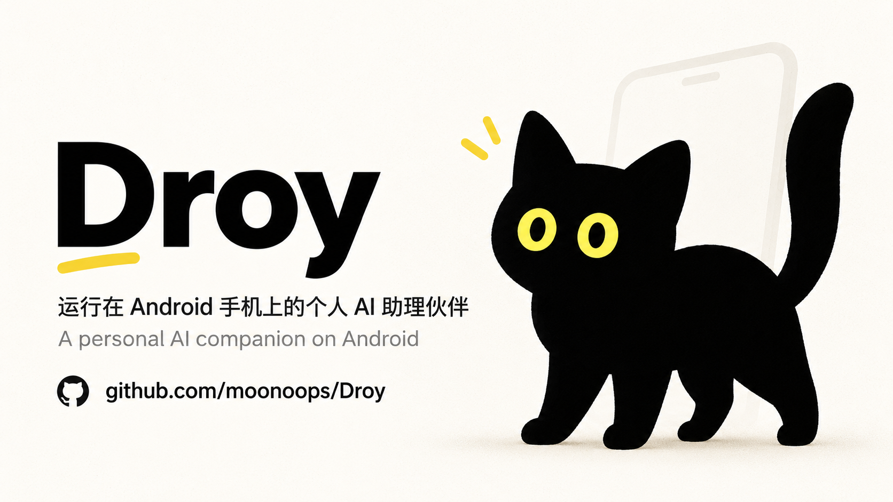
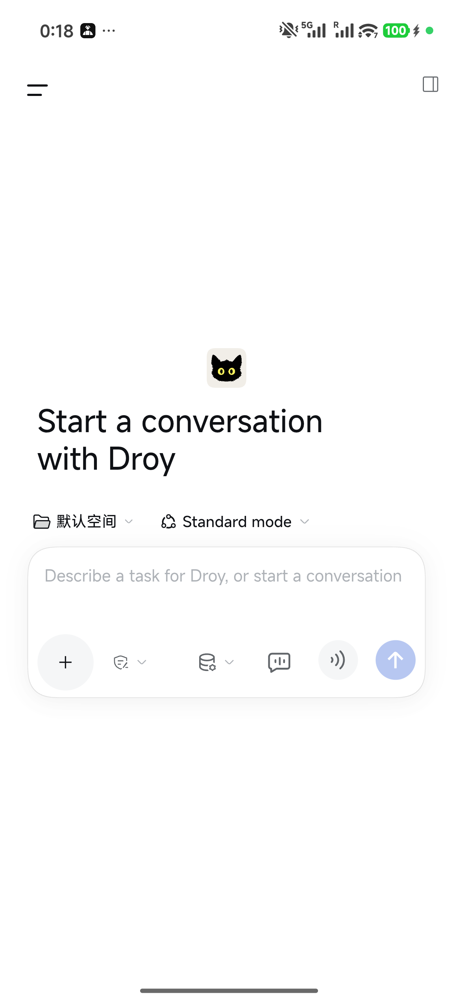
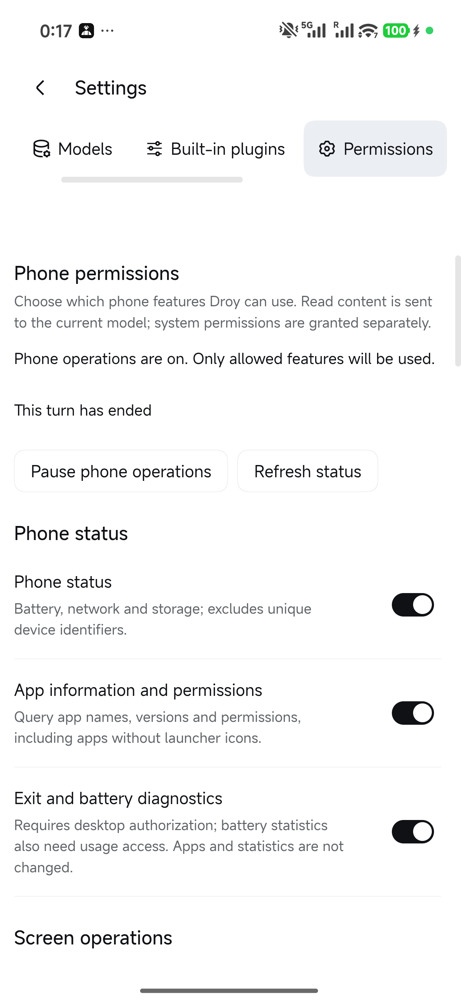
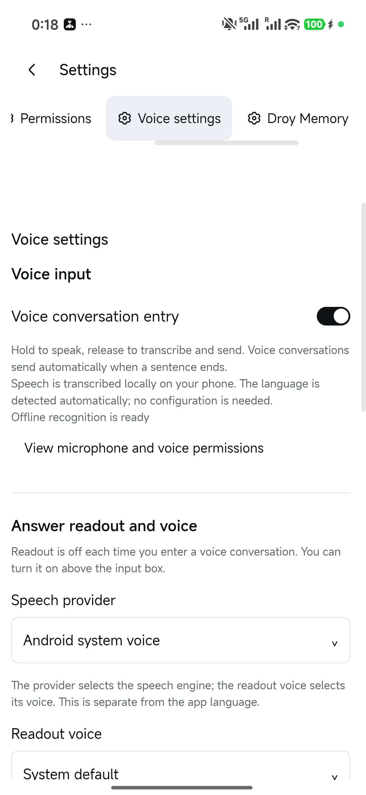
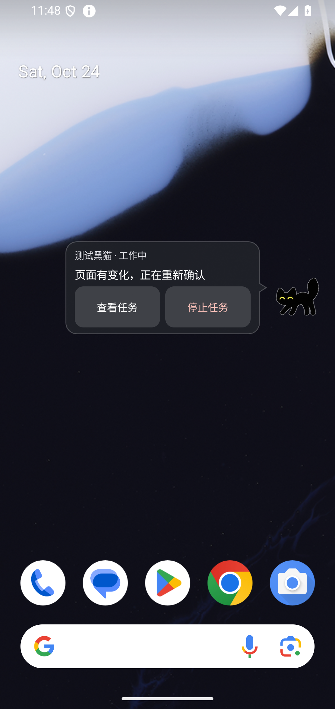
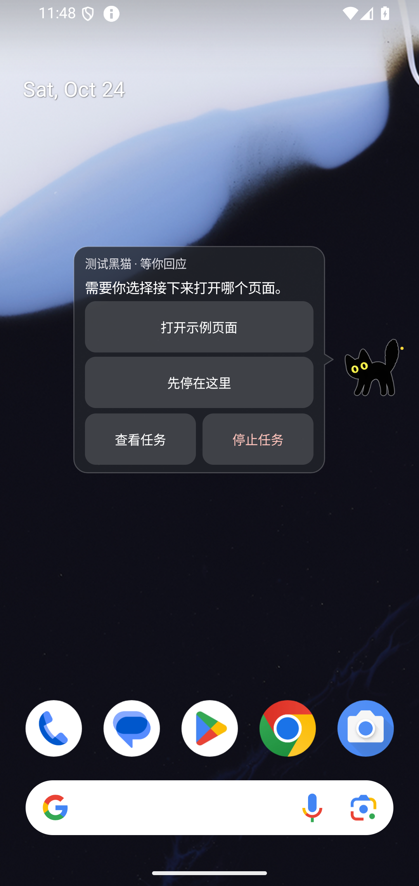
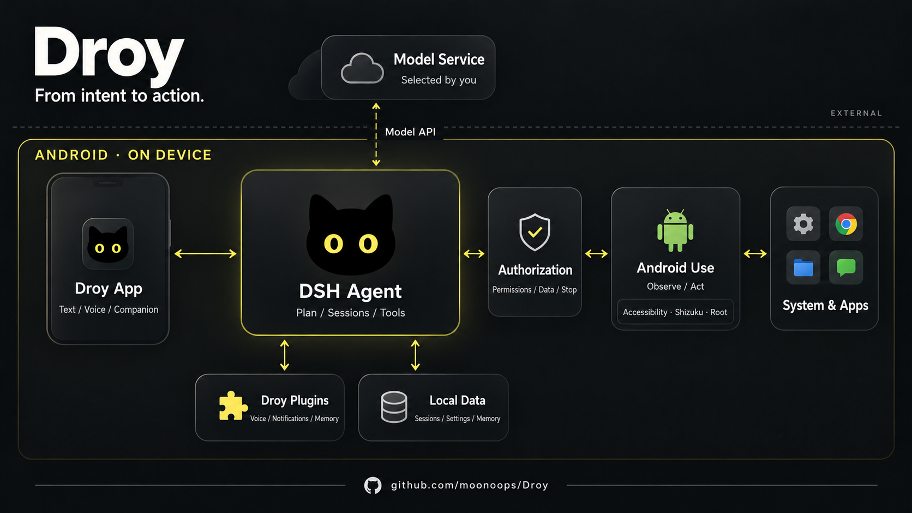

<p align="center">
  
</p>

<div align="center">

**A personal AI companion on Android.**

<strong>English</strong> · [简体中文](README.zh-CN.md)

<p>
<a href="https://github.com/moonoops/Droy/releases/latest"></a>
<a href="#get-started"></a>
<a href="LICENSE"></a>
</p>

**[Download APK](https://github.com/moonoops/Droy/releases/latest)** &nbsp; · &nbsp; [Installation](INSTALLATION.md) &nbsp; · &nbsp; [Issues](https://github.com/moonoops/Droy/issues)

<a href="#preview">Preview</a> &nbsp; / &nbsp; <a href="#get-started">Get&nbsp;started</a> &nbsp; / &nbsp; <a href="#capabilities">Capabilities</a> &nbsp; / &nbsp; <a href="#how-it-works">How&nbsp;it&nbsp;works</a> &nbsp; / &nbsp; <a href="#permissions">Permissions&nbsp;&amp;&nbsp;data</a> &nbsp; / &nbsp; <a href="#development">Development</a>

</div>

---

## What is Droy?

Droy is an Android AI agent built on [DeepSeek Harness (DSH)](https://github.com/deepseek-ai/deepseek-harness). It brings ChatGPT-style conversations and the task execution experience of desktop agents such as Claude Code to your phone. Chat with Droy, or ask it to plan a task and operate your phone through the capabilities you authorize.

For example, ask Droy to install and configure GKD on your phone, or create scheduled tasks to open DingTalk for a daily attendance check-in or claim coupons at a set time. Execution depends on app rules, login state, device permissions and background availability. Login, verification and other steps that need human input are handed back to you.

The agent runtime runs on the phone and can be used without a connected computer after setup. Cloud models require network access and your own model configuration.

<a id="preview"></a>

## Preview

<p align="center">
  <a href="assets/screenshots/chat.en.png"></a>
  <a href="assets/screenshots/permissions.en.png"></a>
  <a href="assets/screenshots/voice.en.png"></a>
</p>

<p align="center"><sub>Conversations · Phone permissions · Local speech</sub></p>

Real screens from Redmi K90 Ultra. Select an image to view it at full size.

<a id="get-started"></a>

## Get started

### Device and compatibility

**Droy is developed on a rooted Redmi K90 Ultra, with implementation paths for both rooted and non-rooted devices. Other devices, system versions and permission combinations need separate compatibility checks.**

- ARM64 Android 11 / API 30 or later, with an up-to-date system WebView.
- Droy's interface supports portrait mode only.
- Without Root, accessibility services provide basic phone interaction; authorized Shizuku can enable some additional operations. Root enables enhanced capabilities. Available features depend on the in-app permission and capability checks. Personal memory works without Root; capture sources and model processing require separate authorization.
- Both vision and text-only models are supported, including compatible services such as DeepSeek Flash. Text-only models operate through page text and control structure. Screenshot understanding requires image input support from the selected model and API, declared in its configuration. Check the [provider's current capabilities](https://api-docs.deepseek.com/guides/vision/) and your actual configuration.

For compatibility problems, an agent can help investigate, modify the source and verify a fix. Share reproduction steps in an [issue](https://github.com/moonoops/Droy/issues) or submit a [pull request](https://github.com/moonoops/Droy/pulls).

### Recommended: USB ADB installation with an agent

1. Connect your phone to a computer using a USB data cable.
2. Enable USB debugging in the phone's developer options and authorize the computer.
3. In a desktop agent client that can run local commands, such as Codex, Claude Code or DSH, enter:

```text
Install Droy on my USB-connected Android phone by following INSTALLATION.md
in https://github.com/moonoops/Droy. Check the device and required tools,
prefer the official signed APK and verify its checksum. Confirm my feature
and permission choices, install through ADB, and run the setup checks.
Prompt me for phone-side confirmations. I will enter my model API key on the phone.
```

4. Complete model setup and permission prompts on the phone, then check the results. You can disconnect USB after setup.

The installer supports macOS, Linux and Windows with Python 3.8+ and ADB. See [installation details](INSTALLATION.md). You can also install the official APK directly and follow the phone setup guide.

After setup, try:

- "Open Calculator and calculate 128 × 24."
- "Summarize the current page in three key points."

<a id="capabilities"></a>

## Capabilities

| Capability | Description |
| --- | --- |
| Conversations | Streaming replies, history, attachments and configurable models. |
| Phone interaction | Open apps, observe pages, take screenshots, tap, swipe and enter text. |
| Voice | Hold to talk, local speech recognition, voice conversations and optional readout. |
| Companion | Built-in pixel-art black cat, marmot and alpaca, with custom artwork and task updates. |
| Chat companion presets | Choose Kaka, Maimai, Dafeiyu or Lady Claude. A fresh installation starts with one Kaka; add other companions from the preset picker. Each keeps its own persona, conversations and memory, with an independently configurable model. |
| Companion chat stickers | Companions can search public sticker sources, download individual images, and install marketplace packs, including animated GIFs. ZIP imports and per-companion pack selections share one local library. [Usage](runtime/mobile/companions/STICKERS.md). |
| Notifications | Content rules, model-assisted analysis and reminders. |
| Personal memory | Optional local records and retrieval, with separate source and processing controls. |
| Extensions | Skills, plugins, MCP and automations through DSH. |
| Languages | Chinese and English. |

Background running uses one silent status notification with current task and stop controls. Companion messages appear separately by conversation, with unread history and a mark-as-read action. During quiet hours, received messages remain silently in the notification shade; proactive contact still follows the companion's quiet-hours setting. Enable message notifications and Android notification permission in settings.

Tasks shows your own tasks and spaces. Each chat companion keeps its background work in its own space; that work appears only through normal chat replies and does not trigger the pet, change your task selection, or return to the app on completion. **Stop processing** in a companion chat stops that companion's current chat and unfinished background work while other companions and your tasks continue.

Notification organization applies only to apps you select. By default it keeps their existing notification settings, removes advertising, and reminds once after an important notification remains uncleared for 5 or 10 minutes. Optional silent takeover requires explicit confirmation and Root access. If classification fails, Droy keeps the original notification and restores settings it owns; settings show failures and any restoration still required. Android force-stop or loss of Root can prevent immediate restoration.

### A companion on your screen

When needed, Droy appears on your screen as the character you select. Speech bubbles tell you what it is doing or ask you to choose the next step and help. You can view the task, answer a question or stop an operation directly.

Choose the built-in black cat, marmot or alpaca in **Settings → Pet**, without configuring an image model. When idle, one tap plays a random animation, favoring signature actions such as kneading, the marmot's scream, or the alpaca's neck stretch and spit. Two or more rapid taps open a small bubble with an idle message and one **Open app** icon. During work, one tap shows current progress with pause, resume and stop icons below. Pausing preserves the task and conversation; the bubble shows **Paused** only after execution has settled. Resuming first checks the current state. If an action's outcome remains uncertain, the bubble explains the issue and does not automatically replay it.

All bubbles use one highly translucent, lightly frosted background across app themes. Questions expand to nearly the screen width, with choices, a manual answer field, and a compact **Skip / Send answer** footer. Ordinary task hints appear at least 30 seconds apart, at most three times per task; errors and questions appear promptly. Background blur follows device support and power-saving state. **Pet studio** lets you preview every action before applying a character.

<details>
<summary><strong>View companion task updates and handoff</strong></summary>

<p align="center">
  <a href="assets/screenshots/companion-progress.png"></a>
  <a href="assets/screenshots/companion-help.png"></a>
</p>

These earlier companion examples use Android emulator demo captures with Chinese UI.

</details>

You can also make Droy your own: give a desktop agent your appearance requirements and the [project URL](https://github.com/moonoops/Droy). Ask it to follow the existing character package format, generate and replace assets, then build and install your customized Droy. Image generation requires an available image generation service.

<a id="how-it-works"></a>

## How it works

DSH provides task planning, model calls and the conversation engine. On top of it, we built **Android Use**, a toolset similar to Computer Use that lets the agent observe pages, tap, type, swipe and check the results of its actions.

Following DSH's “everything is a plugin” philosophy, mobile adaptation, voice interaction and memory connect through plugins, backed by Android native executors. Droy manages permissions, task state, data policy and stop controls, giving DSH the tools to act in an Android environment.

<details>
<summary><strong>View the architecture diagram</strong></summary>

<p align="center">
  <a href="assets/droy-architecture.en.png"></a>
</p>

</details>

<a id="permissions"></a>

## Permissions & data

> [!WARNING]
> Droy is experimental. Despite detailed permission, data authorization and stop controls, model errors, software defects or system differences may still cause unintended actions, data loss or disclosure. Assess the risks, back up important data, grant only necessary permissions and use sensitive accounts with care. The project is provided as is; to the extent permitted by applicable law, its authors and contributors accept no liability for data loss, disclosure or other damage arising from its use.

- Task context, page text, screenshots and attachments may be sent to your selected model. Provider terms and charges apply.
- Voice recognition runs locally; recognized text goes to the conversation model. Readout uses your selected speech engine.
- Notification organization sends selected notification text and your rules to the default model. Recognized verification-code and redacted notifications stay on the device; viewing or editing rules does not send notification history to the model.
- Personal memory and automatic organization are on by default. Activity, page, device-state and location sources are enabled separately; model processing requires authorization for the endpoint, data category and purpose.
- Companion memory is private to each companion and uses local MemOS storage/retrieval with on-device multilingual embeddings. Removing a companion retains its memory on the device; request permanent deletion or restoration explicitly in Tasks. Memory records are not exposed as a browsing interface. Cloud synchronization is not enabled.

You can stop tasks and change capabilities in settings. Background work depends on Android process availability. Before uninstalling, turn off notification management normally so it can restore settings it changed.

<a id="development"></a>

## Development

### Build from source

See [BUILDING.md](BUILDING.md) for the toolchain and build commands, and [TESTING.md](TESTING.md) for checks. Build and runtime versions are pinned in [runtime/release.json](runtime/release.json).

### Feedback and contributions

Use [Issues](https://github.com/moonoops/Droy/issues) for problems and [pull requests](https://github.com/moonoops/Droy/pulls) for verified fixes. Include the Droy version, device, Android version, Root status and reproduction steps. Remove credentials and personal data from shared logs and screenshots.

## Community & acknowledgements

- **[DeepSeek Harness (DSH)](https://github.com/deepseek-ai/deepseek-harness):** Droy is built on its agent engine. Thanks to the DeepSeek team and contributors for their open-source work.
- **LINUX DO Community:** [linux.do](https://linux.do)

[Maintained by @moonoops](https://github.com/moonoops)

## Star history

<div align="center">

<a href="https://www.star-history.com/?repos=moonoops%2FDroy&amp;type=date&amp;legend=top-left">
  <picture>
    <source media="(prefers-color-scheme: dark)" srcset="https://api.star-history.com/chart?repos=moonoops/Droy&amp;type=date&amp;theme=dark&amp;legend=top-left" />
    <source media="(prefers-color-scheme: light)" srcset="https://api.star-history.com/chart?repos=moonoops/Droy&amp;type=date&amp;legend=top-left" />
    
  </picture>
</a>

</div>

## License

Droy's own code is licensed under **GNU AGPL v3.0 only** ([LICENSE](LICENSE)). Use, modification and commercial use are permitted under its terms; applicable source-sharing obligations remain in effect.

Third-party components retain their respective licenses. See [THIRD_PARTY_NOTICES.md](THIRD_PARTY_NOTICES.md).
