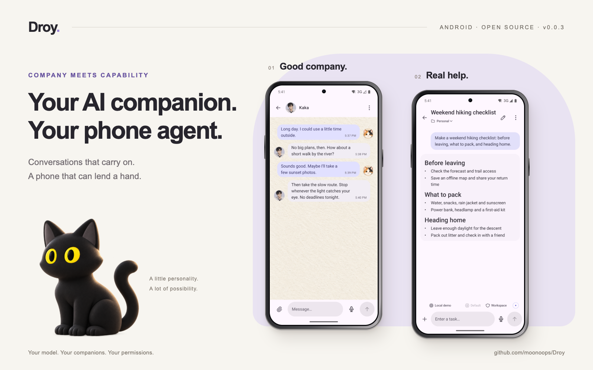
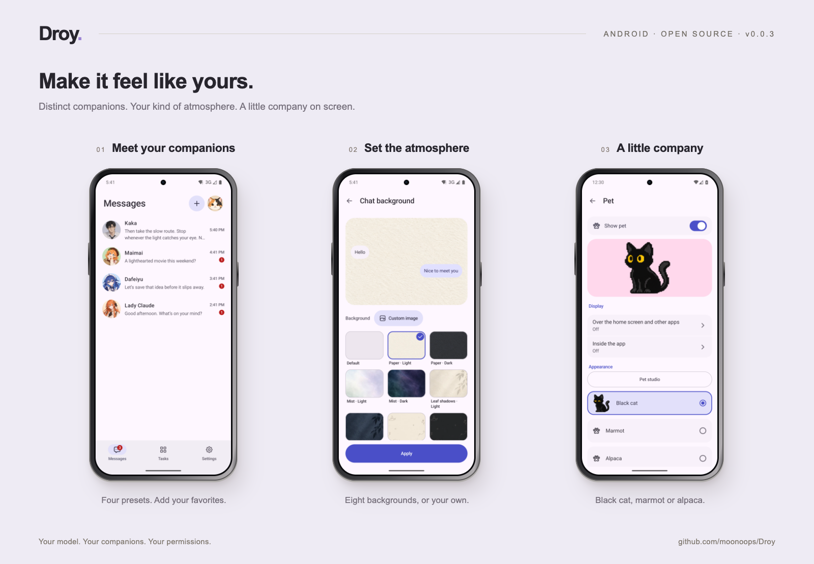

<p align="center">
  <a href="assets/readme/hero.en.png"></a>
</p>

<div align="center">

**A companion to talk to. An agent to act for you. Right on your Android phone.**

<strong>English</strong> · [简体中文](README.zh-CN.md)

<p>
<a href="https://github.com/moonoops/Droy/releases/latest"></a>
<a href="#get-started"></a>
<a href="LICENSE"></a>
</p>

**[Download APK](https://github.com/moonoops/Droy/releases/latest)** &nbsp; · &nbsp; [Installation](INSTALLATION.md) &nbsp; · &nbsp; [What's new in v0.0.3](https://github.com/moonoops/Droy/releases/tag/v0.0.3)

[Companions & memory](#companions) &nbsp; / &nbsp; [Phone agent](#agent) &nbsp; / &nbsp; [Get started](#get-started) &nbsp; / &nbsp; [Permissions & data](#permissions) &nbsp; / &nbsp; [Thanks](#acknowledgements)

</div>

## One phone. Company and capability.

Droy brings **AI companions** and **a task-executing agent** to your Android phone.

In **Messages**, talk about your day, look things up, or pick up yesterday's conversation with a companion who has a personality of their own. Each keeps separate chats, models and memory. In **Tasks**, describe what you want done and let the agent observe the screen, plan the steps and operate your phone through the capabilities you authorize.

The agent runtime lives on your phone. Disconnect your computer after setup and use Droy on its own. You choose the model service; Droy connects conversation, memory and action. Cloud models still require network access and your own API configuration.

**v0.0.3** introduces a native Kotlin / Compose interface with Material 3 Expressive components, four companion presets, local MemOS memory, chat backgrounds, online stickers and GIFs, and reorganized Tasks and settings.

<a id="companions"></a>

## A personality of their own. A memory of you.

Start with Kaka, or get to know Maimai, Dafeiyu and Lady Claude. Customize names, avatars, personalities, expression styles and models to shape how you spend time together. A fresh installation creates one Kaka; add the others when you want.

- **Pick up where you left off.** Companions learn preferences, shared topics, events and agreements from conversation, retrieving local memories to inform later replies.
- **Keep each relationship separate.** Chats, memory and background work are isolated by companion. Each can use a different model.
- **A little initiative. Room for quiet.** Companions can reach out based on real conversations and unfinished topics. Turn proactive contact off or set quiet hours; the default is 22:00–09:00.
- **Say it with a sticker.** Use sticker packs and animated GIFs, search and download from public sticker sources, or import your own packs. [Sticker guide](runtime/mobile/companions/STICKERS.md).

Companions can search the web, gather information and bring their background work back into chat. Phone UI operations start in **Tasks**, described below.

<a id="agent"></a>

## Give your phone a task

Open **Tasks** and describe the goal. Built on [DeepSeek Harness (DSH)](https://github.com/deepseek-ai/deepseek-harness), Droy plans the work and uses Android Use to observe, operate and check the result.

| What you want to do | Capabilities Droy can use |
| --- | --- |
| “Open Calculator and calculate 128 × 24.” | Launch apps, identify controls, tap and type. |
| “Summarize the current page in three key points.” | Read page text and control structure; models with vision support can also interpret screenshots. |
| Hand off a recurring workflow | Use DSH automations with authorized phone capabilities. |
| Give the agent more tools | Connect Skills, plugins and MCP according to the tools and permissions available. |

Execution depends on the model, app state and device permissions. You handle login, verification and other steps that need your input. Tasks can be stopped; the on-screen pet also provides progress and pause, resume and stop controls.

<a id="preview"></a>

## Make Droy yours

<p align="center">
  <a href="assets/readme/everyday.en.png"></a>
</p>

<sub>Actual v0.0.3 Android emulator screens with fictional demo data, presented in rendered phone frames. The cover cat is promotional artwork.</sub>

| Everyday experience | What you can do |
| --- | --- |
| **Native interface** | Chinese and English, light and dark themes, and portrait layouts organized around Messages, Tasks and Settings. |
| **Chat backgrounds** | Choose from eight presets or upload an image, with a different atmosphere for each companion. |
| **Talk out loud** | Hold to talk, use local speech recognition, have voice conversations and optionally hear replies read aloud. |
| **A little company on screen** | Choose a pixel-art black cat, marmot or alpaca. Interact while idle; see progress and answer questions during tasks. |
| **Messages beyond the app** | Receive notifications by companion conversation, keep unread history and mark messages as read. Quiet hours keep delivery silent. |
| **Less notification noise** | Organize notifications for selected apps, clear advertising and get one reminder for important notifications left uncleared. |
| **Personal memory** | Use local records and retrieval without Root. Authorize activity, page, location and other sources separately. |

Background messages and automations depend on Android allowing the app to run. Notification organization preserves existing alerts by default. Optional silent takeover requires explicit confirmation and Root; classification failures keep the original notification and restore settings Droy took over.

<a id="get-started"></a>

## Get started

You need an **ARM64 phone running Android 11 or later**, a recent system WebView, and a compatible model service with your own API key. Choose the capabilities you need during setup.

1. Download the official APK from [Releases](https://github.com/moonoops/Droy/releases/latest), verify it against the attached checksums and install it.
2. Complete setup on your phone: introduce yourself, connect a model, and choose features and permissions. Enter your API key directly on the phone.
3. Say hello to Kaka in **Messages**, or try the Calculator example in **Tasks**.

Without Root, accessibility provides basic phone operations. Shizuku and Root enable some additional capabilities, subject to the in-app checks. Development primarily uses a Redmi K90 Ultra; other devices and system versions need their own compatibility checks. The interface supports portrait mode only.

<details>
<summary><strong>Or ask a desktop agent to install over USB (recommended)</strong></summary>

Connect your phone by USB, enable USB debugging and authorize the computer. Give this prompt to a desktop agent that can run local commands, such as Codex, Claude Code or DSH:

```text
Install Droy on my USB-connected Android phone by following INSTALLATION.md
in https://github.com/moonoops/Droy. Check the device and required tools,
prefer the official signed APK and verify its checksum. Confirm my feature
and permission choices, install through ADB, and run the setup checks.
Prompt me for phone-side confirmations. I will enter my model API key on the phone.
```

Installation supports macOS, Linux and Windows with Python 3.8+ and ADB. Disconnect USB after setup. See the [installation guide](INSTALLATION.md).

</details>

**Upgrading:** Official signed APKs support in-place updates. Older conversations without trusted privacy records remain readable; if continuing one shows an unknown privacy-state warning, start a new conversation. See the [v0.0.3 release notes](https://github.com/moonoops/Droy/releases/tag/v0.0.3).

<a id="permissions"></a>

## You choose what it can do

- **Enable phone capabilities as needed.** System permissions, product authorization and data policies determine what can execute. Change them in settings or stop a task at any time.
- **Local storage has a defined scope.** Companion memory uses local MemOS storage and retrieval with on-device multilingual embeddings. Cloud sync is not enabled. Replies and memory extraction may still use your configured model; local storage does not mean all processing is offline.
- **Know what reaches the model.** Task context, relevant memories, page text, screenshots and attachments may be sent to your chosen provider. Speech recognition runs locally; recognized text goes to the conversation model. Provider terms and charges apply.
- **Choose sources and processing separately.** Personal memory and automatic memory extraction are on by default. Activity, page, device-state and location sources are enabled separately; model processing is authorized by endpoint, data category and purpose.
- **Removing a companion keeps its memory.** Request restoration or permanent deletion explicitly in **Tasks**. Internal memories do not have a separate browsing interface.
- **Notifications also involve data.** Organization sends selected notification text and rules to the default model. Recognized verification-code and redacted notifications stay on the device. Turn notification management off normally before uninstalling so it can restore settings; force-stop or loss of Root may delay restoration.

> [!WARNING]
> Droy is experimental. Model errors, software defects or system differences may cause unintended actions, data loss or disclosure. Back up important data, grant only necessary permissions and use sensitive accounts with care. The project is provided as is; see [LICENSE](LICENSE) for the full terms.

<a id="development"></a>

## Build, report, contribute

Kotlin / Compose provides the native interface. DSH supplies planning, models and sessions. Droy's product services manage authorization, memory, tasks and stop controls; Android Use connects them to native executors.

- [Build guide](BUILDING.md) · [Testing guide](TESTING.md) · [Pinned versions](runtime/release.json)
- [Report an issue](https://github.com/moonoops/Droy/issues) with the Droy version, device, Android version, Root status and reproduction steps. Remove credentials and personal data from logs.
- [Pull requests](https://github.com/moonoops/Droy/pulls) with verified fixes are welcome. Development and production apps use separate package names and keep separate data.

Droy's own code is licensed under [AGPL-3.0-only](LICENSE). Third-party code, models and resources retain their own licenses; see [THIRD_PARTY_NOTICES.md](THIRD_PARTY_NOTICES.md).

<a id="acknowledgements"></a>

## Acknowledgements

Droy builds on the work of open-source communities. Special thanks to:

- **[DeepSeek Harness (DSH)](https://github.com/deepseek-ai/deepseek-harness)** — The planning, model, session and extension engine behind Droy's phone agent.
- **[MemOS](https://github.com/MemTensor/MemOS)** — The local storage and retrieval modules that power companion memory, adapted for Android and isolated by companion. [Integration scope, provenance and licenses](runtime/memory/memos/README.md).
- **[MaiBot](https://github.com/Mai-with-u/MaiBot)** — Open-source conversation planning, replies, Maimai's persona and expression learning, adapted for one-to-one companion chat. [Adaptation notes and license](runtime/mobile/companions/maibot/README.md).
- **[LINUX DO](https://linux.do)** and everyone who contributes feedback, testing and improvements.

[Maintained by @moonoops](https://github.com/moonoops) · If Droy is useful to you, a Star helps others find it.
