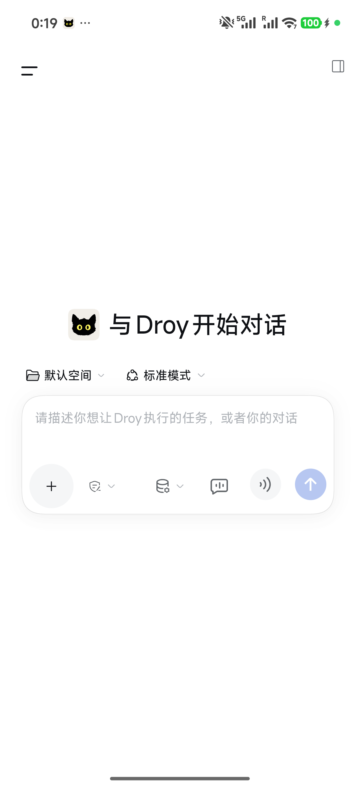
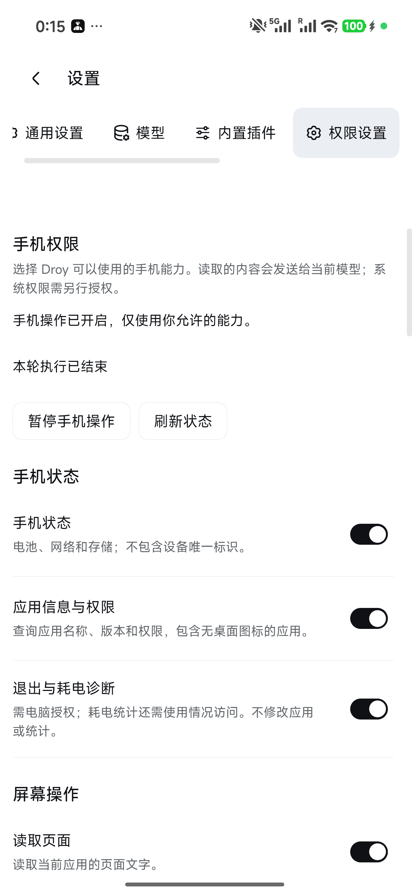
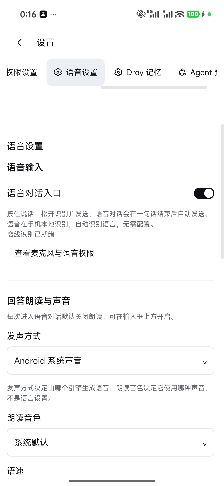

# Droy

**运行在 Android 手机上的个人 AI 助理伙伴。**

[English](README.md) | 简体中文

[下载 APK](https://github.com/moonoops/Droy/releases) · [安装指南](INSTALLATION.md) · [问题反馈](https://github.com/moonoops/Droy/issues) · [@moonoops](https://github.com/moonoops)


## Droy 是什么

Droy 是基于 [DeepSeek Harness（DSH）](https://github.com/deepseek-ai/deepseek-harness) 构建的 Android AI Agent，把类似 ChatGPT 的对话体验和 Claude Code 这类桌面 Agent 的任务执行体验带到手机上。你既可以与 Droy 对话，也可以让它智能规划任务，通过你授权的能力替你操作手机。

例如，让 Droy 帮你在手机上安装并配置 GKD，或创建定时任务，每天打开钉钉打卡、到点领取优惠券。实际执行取决于应用规则、登录状态、设备权限和后台运行条件；登录、验证或其他需要人工处理的步骤，会交回给你。

Agent 运行环境部署在手机本地，配置完成后可以脱离电脑使用。调用云端模型仍需要网络和你自己的模型配置。

## Droy 怎么工作

DSH 提供任务规划、模型调用与会话引擎。我们在其基础上设计了类似 Computer Use 的 **Android Use 工具集**，让 Agent 能观察页面、点击、输入、滑动，并检查操作结果。

遵循 DSH「一切皆插件」的理念，移动端适配、语音交互、记忆等能力通过插件接入，再由 Android 原生执行器提供设备能力。Droy 统一管理权限、任务状态、数据策略和停止控制，让运行在 Android 上的 DSH 有了可用的「手脚」。


### 界面预览

Redmi K90 Ultra 上的真实界面。

| 开始对话 | 能力与授权 | 本地语音 |
| :---: | :---: | :---: |
|  |  |  |

### 屏幕上的小猫伙伴

Droy 会在需要的时候以小猫的形象出现在屏幕上，用气泡告诉你它正在做什么，或请你选择下一步、提供帮助。你可以直接查看任务、回应问题或停止操作。

| 展示任务进度 | 需要你的帮助 |
| :---: | :---: |
|  |  |

小猫气泡示例取自已有的 Android 模拟器演示截图。

形象也可以由你定义：将外观需求和[项目地址](https://github.com/moonoops/Droy)交给电脑端 Agent，让它参照现有形象包格式生成素材、替换资源并构建安装，制作属于你的 Droy。生成图像需要可用的图像生成服务。

## 主要能力

| 能力 | 说明 |
| --- | --- |
| 对话 | 流式回复、会话历史、附件和可配置的模型。 |
| 手机操作 | 打开应用、观察页面、截图、点击、滑动和输入。 |
| 语音 | 按住说话、本地语音识别、语音对话和可选回复朗读。 |
| 伙伴形象 | 可配置外观与性格的动画伙伴，展示任务动态。 |
| 通知管理 | 内容规则、模型辅助分析和提醒。 |
| 个人记忆 | 可选的本地记录与检索，分别控制来源和模型处理授权。 |
| 扩展 | 通过 DSH 使用 Skills、插件、MCP 和自动化。 |
| 语言 | 中文和英文。 |

## 开始使用

### 设备与兼容性

**Droy 基于已 Root 的 Redmi K90 Ultra 开发，同时提供 Root 与非 Root 环境的实现路径。其他机型、系统版本及权限组合需要分别验证兼容性。**

- Android 11 / API 30 及以上的 ARM64 手机，保持系统 WebView 更新。
- 非 Root 环境可通过无障碍服务执行基础手机操作，部分扩展操作可使用已授权的 Shizuku；Root 环境可开启增强能力。实际可用功能以应用内的权限与能力检查为准，个人记忆需要 Root 与执行隔离资格。
- 支持视觉模型与纯文本模型，也可配置 DeepSeek Flash 等兼容服务。纯文本模型通过页面文字和控件结构操作；截图理解需要所选模型及接口支持图像输入，并在配置中声明。模型能力以[服务方当前说明](https://api-docs.deepseek.com/guides/vision/)和实际配置为准。

遇到兼容性问题，可以让 Agent 协助定位、修改源码并验证，通过 [Issue](https://github.com/moonoops/Droy/issues) 提供复现信息，或提交 [Pull Request](https://github.com/moonoops/Droy/pulls) 分享修复。

### 推荐：通过 USB ADB 配合 Agent 安装

1. 使用 USB 数据线连接手机和电脑。
2. 在手机开发者选项中开启 USB 调试，并授权电脑连接。
3. 在能够执行本地命令的电脑端 Agent 客户端中，例如 Codex、Claude Code 或 DSH，输入：

```text
请按 https://github.com/moonoops/Droy 中的 INSTALLATION.md，
将 Droy 安装到我通过 USB 连接的 Android 手机上。先检查设备和所需工具，
优先使用官方签名 APK 并核对校验值。确认我的功能和权限选择后，
通过 ADB 安装、配置并完成自检。需要手机确认的步骤请提示我，
模型 API Key 由我直接在手机填写。
```

4. 在手机完成模型配置和权限确认，核对自检结果。配置完成后可断开 USB 使用。

安装端支持 macOS、Linux 和 Windows，需要 Python 3.8+ 与 ADB。详细流程见[安装指南](INSTALLATION.md)。也可以直接安装官方 APK，并按手机引导配置。

配置完成后，可以试试：

- “打开计算器，计算 128 × 24。”
- “总结当前页面，列出三个要点。”

## 权限与数据

**Droy 是实验性项目。虽然应用内已设计细化的权限、数据授权与停止机制，模型误判、程序缺陷或系统差异仍可能导致误操作、数据丢失或泄露。请自行评估风险、备份重要数据，仅授予必要权限，并谨慎使用敏感账户。项目按现状提供；在适用法律允许的范围内，作者与贡献者不对使用造成的数据丢失、泄露或其他损失承担责任。**

- 任务上下文、页面文字、截图和附件可能发送给当前模型服务，其条款和调用费用由对应服务决定。
- 语音识别在本地运行，识别后的文字提交给对话模型；朗读使用所选语音引擎。
- 通知分析可能发送通知正文，明确的内容规则可在本地执行。
- 个人记忆默认关闭，来源分别开启；模型处理需授权端点、数据类别和用途。

可随时停止任务，在设置中调整能力授权。后台任务依赖 Android 进程可用性。卸载前请正常关闭通知管理，让 Droy 恢复其修改的通知设置。

## 从源码构建

工具链与命令见 [BUILDING.md](BUILDING.md)，检查入口见 [TESTING.md](TESTING.md)。构建与运行版本由 [runtime/release.json](runtime/release.json) 固定。

## 反馈与贡献

通过 [Issues](https://github.com/moonoops/Droy/issues) 反馈问题，通过 [Pull Request](https://github.com/moonoops/Droy/pulls) 提交经过验证的修复。请附上 Droy 版本、机型、Android 版本、Root 状态和复现步骤；分享日志与截图前移除凭据及个人数据。

## 许可

Droy 自有代码采用 **GNU AGPL v3.0 only**（[LICENSE](LICENSE)）。可以按协议使用、修改和商用，并须履行适用的源码提供等义务。

第三方组件继续适用各自许可证，见 [THIRD_PARTY_NOTICES.md](THIRD_PARTY_NOTICES.md)。

## 🤝 社区与致谢

- **[DeepSeek Harness（DSH）](https://github.com/deepseek-ai/deepseek-harness)：** Droy 基于其 Agent 引擎构建，感谢 DeepSeek 团队与贡献者的开源工作。
- **LINUX DO 社区：** [linux.do](https://linux.do)

## Star 趋势

<a href="https://www.star-history.com/?repos=moonoops%2FDroy&amp;type=date&amp;legend=top-left">
  <picture>
    <source media="(prefers-color-scheme: dark)" srcset="https://api.star-history.com/chart?repos=moonoops/Droy&amp;type=date&amp;theme=dark&amp;legend=top-left" />
    <source media="(prefers-color-scheme: light)" srcset="https://api.star-history.com/chart?repos=moonoops/Droy&amp;type=date&amp;legend=top-left" />
    
  </picture>
</a>
