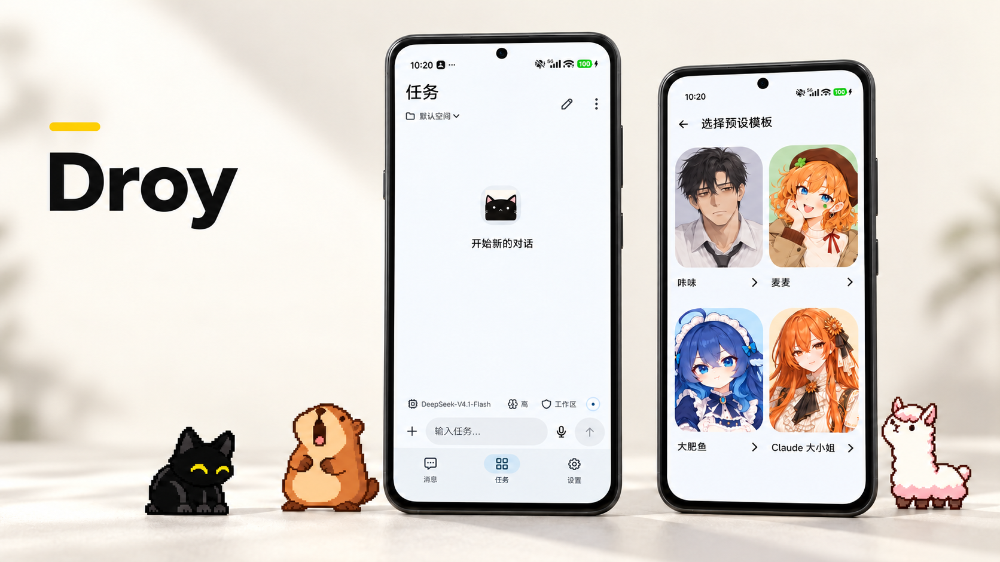
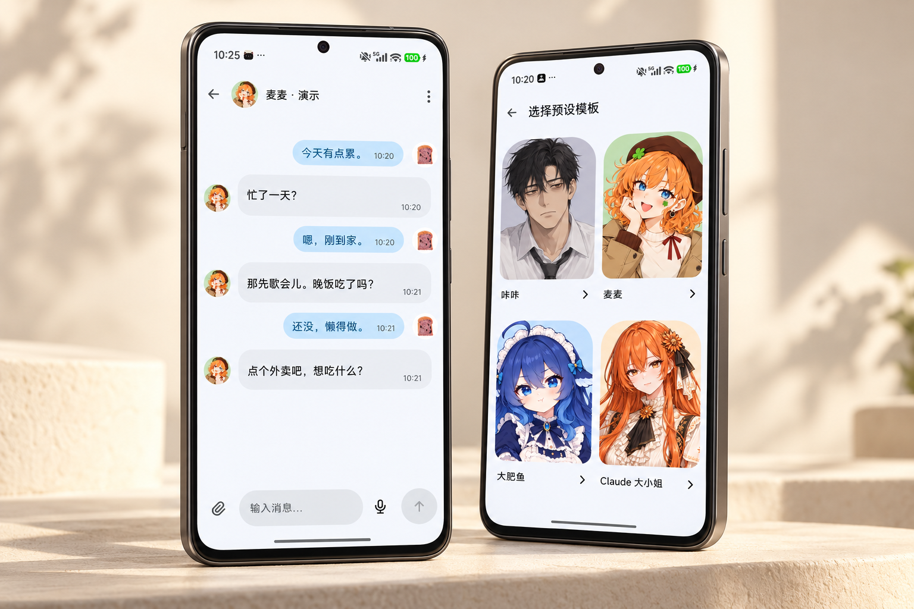
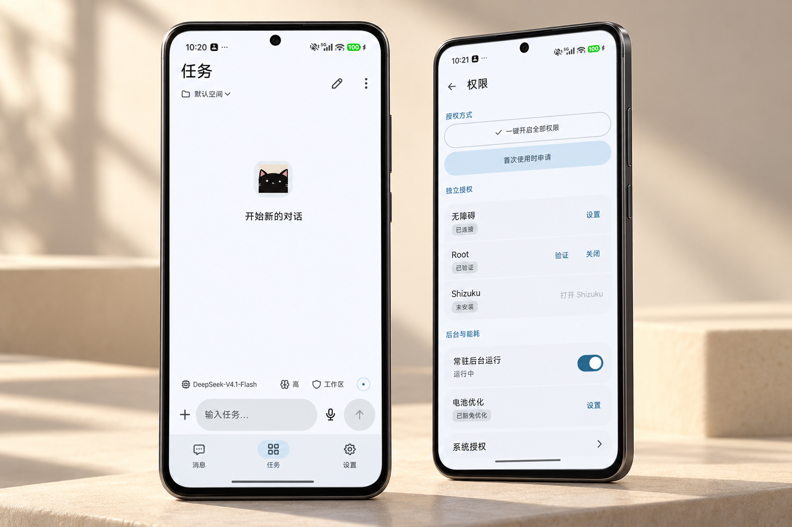
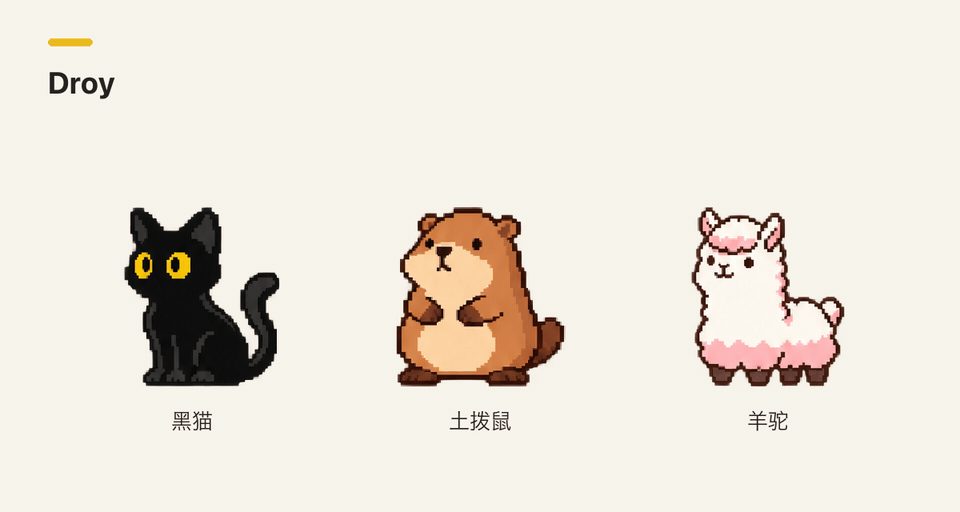

# Droy

[English](README.md) · **简体中文**

<p>
<a href="https://github.com/moonoops/Droy/releases/latest"></a>
<a href="#get-started"></a>
<a href="LICENSE"></a>
</p>

Droy 是一款开源 Android AI 助手，可以和你聊天、查资料，也能按你的要求操作手机。

[**下载 APK**](https://github.com/moonoops/Droy/releases/latest) · [安装指南](INSTALLATION.md) · [v0.0.3 更新记录](https://github.com/moonoops/Droy/releases/tag/v0.0.3) · [反馈问题](https://github.com/moonoops/Droy/issues)

**ARM64** · 中文 / English

[](assets/readme/hero-studio.zh-CN.png)

在「消息」里和伙伴聊天，在「任务」里让 Agent 执行手机操作。运行环境装在手机上，完成配置后就可以断开电脑使用。模型服务由你选择，云端模型需要联网。

[主要功能](#features) · [安装与使用](#get-started) · [权限与数据](#permissions) · [常见问题](#faq) · [开发与贡献](#development)

<a id="features"></a>

## 主要功能

<a id="companions"></a>

### 伙伴聊天

内置咔咔、麦麦、大肥鱼和 Claude 大小姐四个预设。首次安装会创建咔咔，其他伙伴可以按需添加。每个伙伴有自己的聊天记录和记忆，也可以分别选择模型。

- 可以修改名字、头像、性格和说话风格。
- 提供八套聊天背景，也支持上传图片。
- 支持表情包、GIF、在线搜索和图包导入。
- 可以开启主动联系、设置免打扰时间；默认免打扰为 22:00–09:00。

伙伴可以上网查资料、整理信息，也能在后台继续工作，完成后把结果发回聊天。需要打开 App、点击或输入时，从「任务」发起。

[](assets/readme/companions-studio.zh-CN.png)

<a id="agent"></a>

### 手机任务

在「任务」里说清楚要做什么，Agent 会规划步骤，通过 Android Use 查看页面、点击、滑动、输入，并检查结果。你可以添加附件、使用语音输入，也可以用空间和会话整理不同的任务。

登录、验证码等需要你处理的步骤会交回给你。任务进行中可以随时停止。

[](assets/readme/tasks-studio.zh-CN.png)

<a id="pets"></a>

### 屏幕宠物

内置黑猫、土拨鼠和羊驼，可以在宠物工作室切换形象、预览动作。执行任务时，可以通过宠物气泡查看进度、回答提问、暂停、继续或停止任务。

<picture>
  <source media="(prefers-reduced-motion: reduce)" srcset="assets/readme/pets.zh-CN.png">
  
</picture>

<a id="memory"></a>

### 记忆

Droy 会从对话中整理有用的信息，在后续聊天时查找相关记录。每个伙伴的记忆分开保存，也可以在该伙伴的设置中关闭。

伙伴记忆使用 MemOS 的本地存储和检索模块。删除伙伴后，记忆仍保留在手机上；需要恢复或永久删除时，可以在「任务」里提出请求。

[](assets/readme/memory.bilingual.png)

<a id="more"></a>

### 其他功能

| 功能 | 说明 |
| --- | --- |
| 语音 | 按住说话、语音对话和回复朗读。 |
| 通知整理 | 为选中的应用设置通知规则、过滤广告和提醒重要消息。 |
| 原生界面 | Kotlin / Compose，支持中英文、浅色与深色主题，仅支持竖屏。 |
| 扩展 | 通过 DSH 在任务中使用 Skills、插件、MCP 和自动化。 |

<a id="get-started"></a>

## 安装与使用

需要 Android 11 及以上的 ARM64 手机，并保持系统 WebView 更新。

### 直接安装 APK（推荐）

1. 从 [Releases](https://github.com/moonoops/Droy/releases/latest) 下载 APK，在手机上打开并安装。
2. 按引导选择模型服务，在手机上填写 API Key。
3. 配置需要的权限，然后在「消息」里聊天，或到「任务」里输入指令。

安装包已包含运行环境。升级时，请使用相同签名的 APK 覆盖安装。

<details>
  <summary>也可以通过 USB，让电脑端 Agent 帮你安装</summary>

用 USB 连接手机和电脑，在开发者选项中开启 USB 调试，并在手机上授权电脑连接。然后把下面这段话交给能执行本地命令的 Agent：

```text
请按 https://github.com/moonoops/Droy 中的 INSTALLATION.md，
将 Droy 安装到我通过 USB 连接的 Android 手机上。
先检查设备连接和工具，使用官方发布的 APK 并核对校验值。
保留现有数据，根据我的选择配置功能和权限，完成安装和基本检查。
需要我在手机确认时请提醒我，API Key 由我在手机上填写。
```

电脑端工具支持 macOS、Linux 和 Windows，需要 Python 3.8+ 与 ADB。具体步骤见[安装指南](INSTALLATION.md)。

</details>

<a id="troubleshooting"></a>

### 遇到问题，让 Agent 通过 USB 排查

连接手机，开启 USB 调试并授权电脑后，把问题和下面这段话交给电脑端 Agent：

```text
请查看 https://github.com/moonoops/Droy，
排查我通过 USB 连接的手机上 Droy 的问题。
先检查设备连接、应用版本、权限和相关日志，定位原因后修复。
保留我的聊天记录、记忆和配置。
需要我在手机确认时请提醒我，API Key 由我在手机上填写。
```

<a id="permissions"></a>

## 权限与数据

### 权限怎么开

伙伴聊天、屏幕宠物和个人记忆可在非 Root 手机上使用。基础手机操作使用无障碍服务，Shizuku 和 Root 提供部分增强能力。权限页会显示当前可用的能力。

你可以一键开始权限配置，按顺序完成系统确认，也可以选择首次用到时再申请。无障碍、Root 和 Shizuku 分别授权。

个人记忆和自动整理默认开启。手机使用记录、页面内容、设备状态、位置等额外采集来源由你分别开启；可以在设置中调整来源和模型处理授权。

### 哪些内容会交给模型

聊天回复、任务规划和记忆整理使用你配置的模型。根据任务和授权，相关消息、记忆、页面文字、截图及附件会发送给所选模型服务。

- 语音识别在手机上完成，识别出的文字用于对话；朗读使用你选择的语音引擎。
- 通知整理会把需要模型分析的通知正文和整理规则发送给模型。

记忆保存在本机，目前没有云同步。模型调用的费用和数据条款由相应服务商规定。

<a id="faq"></a>

## 常见问题

<details>
  <summary>必须使用 DeepSeek 模型吗？</summary>

不必，可以在设置中添加支持的模型服务。需要理解截图时，选择支持图像输入的模型和接口；纯文本模型可以使用页面文字和控件结构。

</details>

<details>
  <summary>后台收不到消息怎么办？</summary>

打开 Android 通知权限，在 Droy 中开启常驻后台运行，并按手机要求设置电池和自启动权限。系统强停或重启后，重新打开 Droy。

</details>

<details>
  <summary>通知整理会改动原应用的提醒吗？</summary>

默认保留原应用的提醒。静默接管需要单独确认和 Root。卸载前先关闭通知整理，并检查相关设置是否恢复。系统强停或失去 Root 后，重新打开 Droy 并授予所需权限，再检查恢复结果。

</details>

<a id="development"></a>

## 开发与贡献

原生界面基于 Kotlin / Compose。DSH 提供 Agent 规划、模型调用和会话能力，Droy 管理授权、任务状态和数据，Android Use 连接手机的原生执行器。

[构建指南](BUILDING.md) · [测试指南](TESTING.md) · [依赖版本](runtime/release.json)

反馈问题时，请附上 Droy 版本、机型、Android 版本、Root 状态和复现步骤。分享日志与截图前移除密钥和个人信息。修复和改进可以提交 [Pull Request](https://github.com/moonoops/Droy/pulls)。

<a id="acknowledgements"></a>

## 致谢

- **[DeepSeek Harness（DSH）](https://github.com/deepseek-ai/deepseek-harness)**：提供 Agent 引擎、模型调用、会话和扩展能力。
- **[MaiBot（麦麦）](https://github.com/Mai-with-u/MaiBot)**：Droy 使用并适配了它的对话规划与回复模板、麦麦的人格设定，以及表达学习相关实现。[适配说明](runtime/mobile/companions/maibot/README.md)。
- **[MemOS](https://github.com/MemTensor/MemOS)**：提供伙伴记忆的本地存储与检索模块，Droy 在此基础上做了 Android 适配和伙伴隔离。[集成说明](runtime/memory/memos/README.md)。

感谢这些项目的作者和贡献者开放源码，也感谢 [LINUX DO 社区](https://linux.do)及帮助 Droy 测试、反馈和改进的用户。

<a id="license"></a>

## 许可

Droy 自有代码使用 [AGPL-3.0-only](LICENSE) 许可。第三方代码、模型和素材适用各自的许可，见 [THIRD_PARTY_NOTICES.md](THIRD_PARTY_NOTICES.md)。

维护者：[@moonoops](https://github.com/moonoops)

<a id="star-history"></a>

## Star 趋势

<div align="center">

<a href="https://www.star-history.com/?repos=moonoops%2FDroy&amp;type=date&amp;legend=top-left">
  <picture>
    <source media="(prefers-color-scheme: dark)" srcset="https://api.star-history.com/chart?repos=moonoops/Droy&amp;type=date&amp;theme=dark&amp;legend=top-left" />
    <source media="(prefers-color-scheme: light)" srcset="https://api.star-history.com/chart?repos=moonoops/Droy&amp;type=date&amp;legend=top-left" />
    
  </picture>
</a>

</div>
