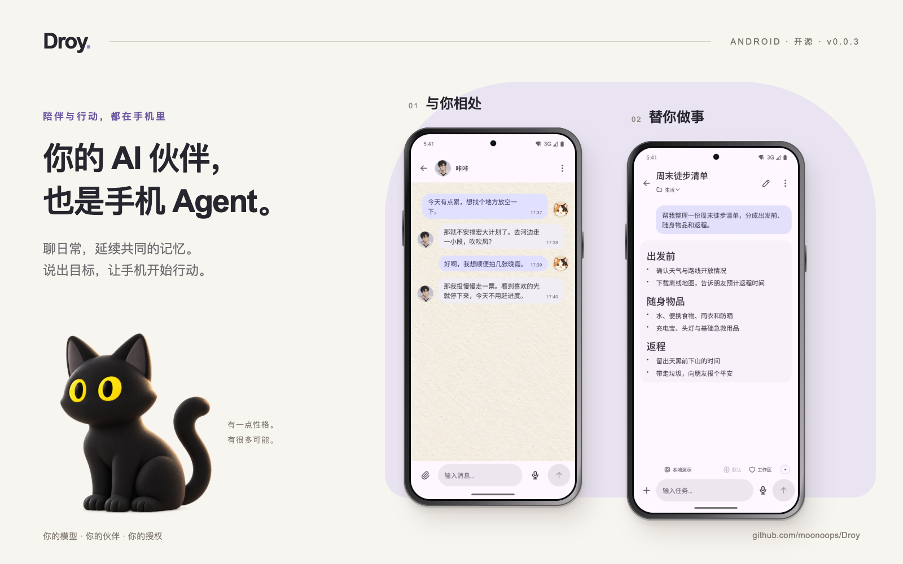
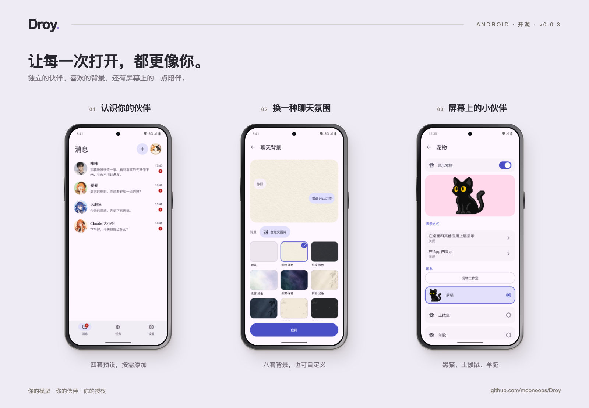

<p align="center">
  <a href="assets/readme/hero.zh-CN.png"></a>
</p>

<div align="center">

**陪你聊天，记住相处的点滴。在你授权下，替你操作手机。**

[English](README.md) · <strong>简体中文</strong>

<p>
<a href="https://github.com/moonoops/Droy/releases/latest"></a>
<a href="#get-started"></a>
<a href="LICENSE"></a>
</p>

**[下载 APK](https://github.com/moonoops/Droy/releases/latest)** &nbsp; · &nbsp; [安装指南](INSTALLATION.md) &nbsp; · &nbsp; [v0.0.3 更新](https://github.com/moonoops/Droy/releases/tag/v0.0.3)

[伙伴与记忆](#companions) &nbsp; / &nbsp; [手机 Agent](#agent) &nbsp; / &nbsp; [开始使用](#get-started) &nbsp; / &nbsp; [权限与数据](#permissions) &nbsp; / &nbsp; [致谢](#acknowledgements)

</div>

## 一部手机，两种相处方式

Droy 把 **AI 伙伴**和**能执行任务的 Agent** 放进你的 Android 手机。

在「消息」里，和有自己性格的伙伴聊日常、找资料、继续昨天的话题。每个伙伴有独立的聊天、模型和记忆。在「任务」里，说出你想做的事，让 Agent 观察页面、规划步骤，并通过已授权的能力操作手机。

Agent 运行环境就在手机上，配置后可以断开电脑使用。你选择模型服务，Droy 负责把对话、记忆与行动连接起来；云端模型仍需联网，并使用你自己的 API 配置。

**v0.0.3** 带来了 Kotlin / Compose 原生界面、Material 3 Expressive 组件、四套伙伴预设、本地 MemOS 记忆、聊天背景、在线表情与 GIF，以及重新整理的任务和设置入口。

<a id="companions"></a>

## 有自己的性格，也记得你

从咔咔开始，也可以认识麦麦、大肥鱼和 Claude 大小姐。你可以调整名字、头像、人格、表达风格与模型，慢慢形成你们自己的相处方式。新安装只创建一个咔咔，其余伙伴按需添加。

- **聊过的事，可以接着聊。** 伙伴会从交流中积累偏好、共同话题、事件与约定，用本地记忆检索为后续对话补充上下文。
- **每段关系各自延续。** 不同伙伴的聊天、记忆与后台工作分别隔离，也可以各自使用不同模型。
- **有来有回，也留一点安静。** 伙伴可以根据真实聊天和未完话题主动联系；可关闭主动联系，或设置免打扰时间，默认是 22:00–09:00。
- **表达不只是一段文字。** 支持表情包、GIF 动图、公开图库搜索与下载，也能导入自己的图包。[表情包说明](runtime/mobile/companions/STICKERS.md#表情包图包)。

伙伴能搜索网页、整理资料，并把自己后台工作的结果带回聊天。手机界面操作从下方的「任务」入口发起。

<a id="agent"></a>

## 想做的事，交给任务 Agent

进入「任务」，用自然语言说明目标。Droy 基于 [DeepSeek Harness（DSH）](https://github.com/deepseek-ai/deepseek-harness) 规划任务，通过 Android Use 观察和操作手机，并检查执行结果。

| 你想做的事 | Droy 可以调用的能力 |
| --- | --- |
| “打开计算器，计算 128 × 24。” | 启动应用、识别控件、点击和输入。 |
| “总结当前页面，列出三个要点。” | 读取页面文字与控件结构；支持视觉的模型还可理解截图。 |
| 把重复工作交给 Agent | 使用 DSH 自动化，结合手机能力执行已配置的流程。 |
| 为任务增加工具 | 接入 Skills、插件和 MCP，按实际工具与权限扩展能力。 |

执行能力取决于模型、应用状态和设备授权。登录、验证以及其他需要你介入的步骤由你完成；任务可以停止，屏幕宠物也提供进度与暂停、继续、停止入口。

<a id="preview"></a>

## 让它成为你自己的 Droy

<p align="center">
  <a href="assets/readme/everyday.zh-CN.png"></a>
</p>

<sub>v0.0.3 Android 模拟器实际界面，使用虚构演示数据；手机外框为渲染展示。封面黑猫为宣传插画。</sub>

| 日常体验 | 你可以怎样使用 |
| --- | --- |
| **原生界面** | 中文与英文、浅色与深色主题，围绕消息、任务和设置组织的竖屏体验。 |
| **聊天背景** | 八套预设背景，也可上传自己的图片，让不同伙伴拥有不同的聊天氛围。 |
| **开口聊** | 按住说话、本地语音识别、语音对话与可选的回复朗读。 |
| **屏幕上的小伙伴** | 选择像素黑猫、土拨鼠或羊驼；空闲时互动，工作时看进度、回应问题。 |
| **离开界面，仍能收到消息** | 按伙伴会话显示通知，保留未读消息，可直接标为已读；免打扰期间静默投递。 |
| **少一点通知打扰** | 为选中的应用整理通知，清理广告，并对持续未处理的重要通知提醒一次。 |
| **个人记忆** | 无需 Root 即可使用本地记录与检索；手机使用、页面、位置等来源由你分别授权。 |

后台消息与自动化依赖 Android 允许应用持续运行。通知整理默认保留原应用提醒；可选的静默接管需要明确确认和 Root，模型分类失败时保留原通知并恢复由 Droy 接管的设置。

<a id="get-started"></a>

## 开始使用

需要 **Android 11 及以上的 ARM64 手机**和较新的系统 WebView。准备一个兼容的模型服务与 API Key，按引导选择需要的能力。

1. 从 [Releases](https://github.com/moonoops/Droy/releases/latest) 下载官方 APK，按附件校验和核对后安装。
2. 在手机完成首次配置：设置你的资料、连接模型、选择功能与授权。API Key 直接在手机填写。
3. 去「消息」和咔咔打个招呼，或进入「任务」试试计算器示例。

非 Root 设备可通过无障碍执行基础手机操作；Shizuku 和 Root 提供部分增强能力，以应用内的能力检查为准。项目主要基于 Redmi K90 Ultra 开发，其他机型与系统的兼容性仍需分别验证。界面仅支持竖屏。

<details>
<summary><strong>也可以让电脑端 Agent 通过 USB 帮你安装（推荐）</strong></summary>

使用 USB 连接手机、开启 USB 调试并授权电脑后，把下面这段话交给能执行本地命令的 Codex、Claude Code 或 DSH：

```text
请按 https://github.com/moonoops/Droy 中的 INSTALLATION.md，
将 Droy 安装到我通过 USB 连接的 Android 手机上。先检查设备和所需工具，
优先使用官方签名 APK 并核对校验值。确认我的功能和权限选择后，
通过 ADB 安装、配置并完成自检。需要手机确认的步骤请提示我，
模型 API Key 由我直接在手机填写。
```

安装端支持 macOS、Linux 和 Windows，需要 Python 3.8+ 与 ADB。完成后可以断开 USB，详情见[安装指南](INSTALLATION.md)。

</details>

**从旧版升级：** 官方签名 APK 支持覆盖安装。缺少可信隐私记录的旧会话仍可查看；若继续发送时提示隐私状态未知，请新建对话。详见 [v0.0.3 发布说明](https://github.com/moonoops/Droy/releases/tag/v0.0.3)。

<a id="permissions"></a>

## 能做多少，由你授权

- **手机能力按需开启。** 系统权限、产品授权与数据策略共同决定能否执行；可在设置中调整，也可随时停止任务。
- **本地存储有明确边界。** 伙伴记忆使用本地 MemOS 存储与检索、手机端多语言 embedding，当前未启用云同步。回复和记忆提炼仍可能调用配置的模型，本地存储不代表所有处理都离线。
- **发往模型的内容要知情。** 任务上下文、相关记忆、页面文字、截图和附件可能发送给所选模型服务。语音识别在本地完成，识别文字交给对话模型；费用与数据条款取决于服务方。
- **来源和用途分别选择。** 个人记忆与自动提炼记忆默认开启，但手机使用记录、页面、设备状态和位置来源需分别开启；模型处理按端点、数据类别与用途授权。
- **删除伙伴不等于清空记忆。** 移除伙伴后记忆仍在本机保留。需要恢复或永久删除时，请在「任务」中明确提出；内部记忆没有单独的浏览入口。
- **通知也涉及数据。** 整理会把所选通知正文与规则发送给默认模型；识别出的验证码与已隐藏敏感内容的通知留在本机。卸载前正常关闭通知管理，以便恢复设置；强停或失去 Root 可能延迟恢复。

> [!WARNING]
> Droy 仍是实验性项目。模型误判、程序缺陷或系统差异可能导致误操作、数据丢失或泄露。请备份重要数据，仅授予必要权限，并谨慎使用敏感账户。项目按现状提供；完整许可条款见 [LICENSE](LICENSE)。

<a id="development"></a>

## 构建、反馈与贡献

原生界面使用 Kotlin / Compose；DSH 提供规划、模型与会话引擎；Droy 产品服务管理授权、记忆、任务和停止控制；Android Use 将这些能力连接到原生执行器。

- [构建指南](BUILDING.md) · [测试指南](TESTING.md) · [固定版本](runtime/release.json)
- [反馈问题](https://github.com/moonoops/Droy/issues)时，请附上版本、机型、Android 版本、Root 状态及复现步骤，移除日志中的密钥与个人数据。
- 欢迎提交经过验证的 [Pull Request](https://github.com/moonoops/Droy/pulls)。开发版与正式版使用独立包名，数据分别保存。

Droy 自有代码采用 [AGPL-3.0-only](LICENSE)。第三方代码、模型与素材适用各自许可证，见 [THIRD_PARTY_NOTICES.md](THIRD_PARTY_NOTICES.md)。

<a id="acknowledgements"></a>

## 致谢

Droy 建立在许多开源项目的工作之上，特别感谢：

- **[DeepSeek Harness（DSH）](https://github.com/deepseek-ai/deepseek-harness)** — 提供 Agent 规划、模型调用、会话与扩展引擎，是 Droy 手机任务能力的基础。
- **[MemOS](https://github.com/MemTensor/MemOS)** — 为伙伴记忆提供实际运行的本地存储与检索模块。Droy 做了 Android 适配与伙伴隔离；[集成范围、来源和许可](runtime/memory/memos/README.md)。
- **[MaiBot（麦麦）](https://github.com/Mai-with-u/MaiBot)** — 提供对话规划、回复、麦麦人格及表达学习等开源实现。Droy 将相关源码适配到一对一伙伴聊天；[适配说明与许可](runtime/mobile/companions/maibot/README.md)。
- **[LINUX DO 社区](https://linux.do)**，以及所有提供反馈、测试与贡献的朋友。

[由 @moonoops 维护](https://github.com/moonoops) · 如果 Droy 对你有用，欢迎留下一个 Star。
